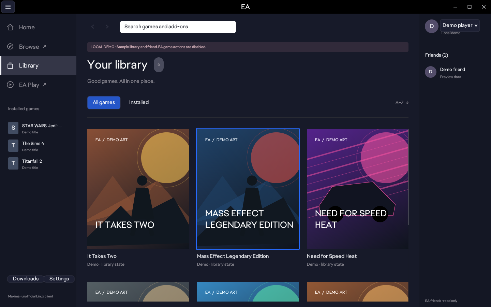

# AE app for Linux

An experimental native Linux client based on [Maxima](https://github.com/ArmchairDevelopers/Maxima), with an EA app inspired interface and per-game Proton settings. The application window is titled **EA for Linux · Maxima**.

This is an unofficial community fork, independent of Electronic Arts. The launcher runs natively on Linux; supported Windows games run through [umu](https://github.com/Open-Wine-Components/umu-launcher) and Proton. Compatibility depends on each game, its DRM, and its anti-cheat requirements.



The screenshot shows local demo data and original geometric placeholder artwork. Sample titles do not represent account ownership or verified game compatibility.

## Try the interface

Install the prerequisites in the [Linux guide](README-LINUX.md), then build and launch the local preview:

```sh
./scripts/build-linux.sh
./target/release/maxima --preview
```

Preview mode uses local sample data. It starts no EA backend, performs no account login, and disables game launches and installations. It does not download games or Proton runtimes or save changes to normal frontend settings.

```sh
./target/release/maxima --preview --preview-page home
./target/release/maxima --preview --preview-page settings
./target/release/maxima --preview --preview-page game
./target/release/maxima --preview --preview-page proton
./target/release/maxima --preview --screenshot /tmp/ae-linux-library.png
```

The available preview pages are `library`, `home`, `settings`, `game`, and `proton` (the game settings dialog). Screenshots require an X11 or Wayland display and an existing destination directory.

To create a local binary folder with launcher scripts after building:

```sh
./scripts/package-linux.sh
./dist/EA-for-Linux/Preview.sh
```

The package contains `maxima`, `maxima-bootstrap`, `maxima-cli`, `EA-for-Linux.sh`, `Preview.sh`, the Linux guide, and the license. `EA-for-Linux.sh` opens normal mode, which requires the browser callback setup described in the guide.

## What this fork includes

- A native library grid, game details, home, downloads, and settings interface.
- A clearly marked local preview for exploring the UI without an EA account.
- The existing Maxima account, library, download, import, cloud-save, and game-launch integration.
- Per-game selection of an absolute Proton installation directory, Proton logging, and Esync/Fsync controls.
- Managed GE-Proton and umu runtime preparation through Maxima, with a shared Wine prefix.
- A stable Rust 1.93.0 toolchain, a committed `Cargo.lock`, and Linux build/preview CI.

Normal mode opens EA sign-in in the system browser. Keep `maxima`, `maxima-bootstrap`, and `maxima-cli` together: the sibling bootstrap handles both game launching and the `qrc:` login callback. See the [Greek quick start and technical guide](README-LINUX.md) for protocol setup, data locations, build prerequisites, and Proton settings.

## Current scope

This is experimental software. Real EA account login, entitlement retrieval, downloads, cloud saves, and real game launches have **not been validated end to end for this fork**. Existing Maxima functionality is inherited code, not a guarantee that every account or title works.

Storefront purchases, DLC installation, and UI stop/uninstall controls are incomplete. Some games cannot run on Linux because of their anti-cheat or other platform requirements. Consult [EA's Javelin requirements](https://help.ea.com/en/articles/platforms/pc-ea-anticheat/) and the compatibility information for the specific game. The original upstream description and its limitations are preserved in [README-UPSTREAM.md](README-UPSTREAM.md).

## Build and checks

The repository pins **Rust 1.93.0 stable**. A Linux C/C++ toolchain, `pkg-config`, `protobuf-compiler` (`protoc`), and the desktop graphics libraries are required; see [README-LINUX.md](README-LINUX.md).

```sh
cargo test --locked -p maxima-lib --lib
cargo build --locked --release -p maxima-ui -p maxima-bootstrap -p maxima-cli
```

The recorded library-test result is **6 passed, 2 ignored**. The ignored upstream tests require an authenticated EA account and live Battlefront II cloud saves; one can write to those saves. They are excluded from unattended CI.

The Linux workflow builds on Ubuntu 24.04 with two Cargo build jobs, runs the library tests, renders a preview screenshot under Xvfb with isolated XDG directories, and uploads the native binaries and screenshot as build artifacts. A CI preview checks the local interface, not EA authentication or game compatibility.

Local verification on Ubuntu 26.10 x86_64: release binaries built successfully with Rust 1.93.0; library, Home, account settings and Proton modal screenshots rendered under Xvfb. Six library tests passed, two live-account tests were ignored. The traced preview made no IPv4/IPv6 calls and launched no helper executable. Screenshots use locally imported EA fonts; the source build falls back to the bundled font. GitHub CI has not yet been verified.

## Upstream and license

Built on [ArmchairDevelopers/Maxima](https://github.com/ArmchairDevelopers/Maxima), with [umu](https://github.com/Open-Wine-Components/umu-launcher) and [GE-Proton](https://github.com/GloriousEggroll/proton-ge-custom) providing the game runtime path.

The source is distributed under **GPL-3.0**; see [LICENSE](LICENSE). Original Maxima attribution remains in [README-UPSTREAM.md](README-UPSTREAM.md). EA and game names belong to their respective owners.


## Original-client investigation

The supplied Windows/macOS reference clients were statically inspected. See the [evidence and compatibility gap report](docs/reverse-engineering.md). This is a working native milestone toward the clone goal, not verified 100% original-client parity. Optional original fonts can be imported locally with `scripts/import-ea-fonts.py`; original EA binaries/resources are not committed.
