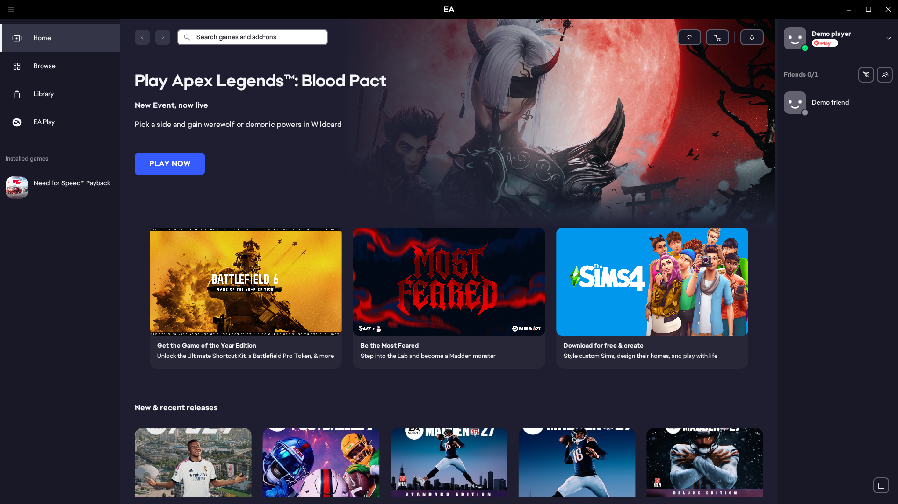

# aeapp

An experimental native Linux client for Windows EA games, with an interface measured from the Windows EA app and per-game Proton settings. The application window and installed launcher are named **aeapp**.

This is an unofficial community fork, independent of Electronic Arts. The launcher runs natively on Linux; supported Windows games run through [umu](https://github.com/Open-Wine-Components/umu-launcher) and Proton. Compatibility depends on each game, its DRM, and its anti-cheat requirements.



The screenshots use local demo account data, optionally imported EA fonts, and official public artwork. Sample games do not represent account ownership or verified Linux compatibility. Imported reference assets are excluded from source; builds without them use fallback fonts, icons and artwork.

## Try the interface

Install the prerequisites in the [Linux guide](README-LINUX.md), then build and launch the local preview:

```sh
./scripts/build-linux.sh
./target/release/aeapp --preview
```

Preview mode uses local sample data. It starts no EA backend, performs no account login, and disables game launches and installations. It does not download games or Proton runtimes or save changes to normal frontend settings.

```sh
./target/release/aeapp --preview --preview-page home
./target/release/aeapp --preview --preview-page downloads
./target/release/aeapp --preview --preview-page settings
./target/release/aeapp --preview --preview-page game
./target/release/aeapp --preview --preview-page proton
./target/release/aeapp --preview --screenshot /tmp/ae-linux-library.png
```

The available preview pages are `library`, `home`, `browse`, `ea-play`, `profile`, `downloads`, `settings`, `game`, and `proton` (the game settings dialog). Use `--preview-page game --preview-game-tab 0`, `1`, or `2` to inspect the Game Hub tabs. Screenshots require an X11 or Wayland display and an existing destination directory.

To create a local binary folder with launcher scripts after building:

```sh
./scripts/package-linux.sh
./dist/AEApp-for-Linux/aeapp-preview.sh
```

The package contains `aeapp`, `aeapp-bootstrap`, `aeapp-cli`, `aeapp.sh`, `aeapp-preview.sh`, a user installer, the bundled fallback icon, the Linux guide, credits, and the license. `aeapp.sh` opens normal mode, which requires the browser callback setup described in the guide.

## Install for your user

After building, run:

```sh
./scripts/install-linux.sh --from target/release
```

For an extracted binary package, run `./install-linux.sh` inside its directory. No root access is required. The installer adds **aeapp** to the application menu, installs the binaries in `${XDG_DATA_HOME:-$HOME/.local/share}/ae-app-for-linux`, and creates `~/.local/bin/aeapp`. Run that command or use the application menu to start the app. Re-running the installer updates the binaries while preserving existing account/game data and locally imported assets.

To use your own local EA fonts and original PNG icon, provide them explicitly:

```sh
./scripts/install-linux.sh --from target/release \
  --assets-dir /path/to/local/ea-assets \
  --icon /path/to/local/ea-icon.png
```

The assets directory may contain regular/bold EA Text and Display fonts, `icon.png`, static `icons/*.svg`, and local `covers`, `promotions`, and `catalog` artwork. Imported assets stay on your machine and are excluded from Git; a fresh default package uses bundled fallback assets. Only these static assets and the known source catalog JSON files are copied, with no symlinks, account files, or cache directories. Existing local assets are preserved. The installer copies the selected icon without resizing it. The installed wrapper sets `AEAPP_INSTALLED=1` and registers the hidden `aeapp-qrc.desktop` browser callback handler. Installation does not launch the app or sign in to an account.

To include those assets in a package for your own machine, pass `--assets-dir` explicitly:

```sh
./scripts/package-linux.sh /path/to/local/package --assets-dir /path/to/local/ea-assets
```

The optional [official public catalog](https://store.ea.com/commerce/app/products) can be cached manually for native Browse:

```sh
python3 scripts/import-ea-catalog.py /path/to/local/ea-assets/catalog
```

The importer saves up to 30 actual products and 20 official artwork images. It preserves the anonymous page's price and currency labels, which may differ by region and time. Browse reads this local cache; preview rendering does not fetch it automatically. Product links open the official store, and purchases remain in EA's external flow. Catalog presence does not imply ownership, subscription inclusion, or Linux compatibility.

## What this fork includes

- Native Home, Browse, EA Play, profile, library and settings screens, plus a Windows-style Game Hub with Overview, Currency and Add-ons tabs.
- A clearly marked local preview for exploring the UI without an EA account.
- Account, library, download, import, cloud-save, and game-launch integration.
- Per-game selection of an absolute Proton installation directory, Proton logging, and Esync/Fsync controls.
- Managed GE-Proton and umu runtime preparation through aeapp, with a shared Wine prefix.
- Download pause/resume/cancel, **Download next** reordering, removal of waiting items, and a persistent queue.
- **Stop** for the active Linux game, **Open game folder**, and an explicit **Refresh library** that bypasses the ownership-cache interval.
- A stable Rust 1.93.0 toolchain, a committed `Cargo.lock`, and Linux build/preview CI.

Normal mode opens EA sign-in in the system browser. Keep `aeapp`, `aeapp-bootstrap`, and `aeapp-cli` together: the sibling bootstrap handles both game launching and the `qrc:` login callback. See the [Greek quick start and technical guide](README-LINUX.md) for protocol setup, data locations, build prerequisites, and Proton settings.

## System tray

On Linux desktops with a StatusNotifierItem host, aeapp registers the installed application icon and an **Open aeapp / Settings / Exit** menu. Closing the window hides it only after tray registration succeeds. Open restores the window; Settings restores it on the settings page; Exit ends the client. If the tray disappears or its worker fails, a hidden window is restored. On desktops without a tray host, closing exits normally. The current window stack uses X11/XWayland when `DISPLAY` is available because its native Wayland backend cannot hide a window; pure Wayland without XWayland has not been validated for close-to-tray. GNOME needs a StatusNotifierItem/AppIndicator host. Local preview mode never registers a tray or connects to D-Bus.

## Downloads and game controls

The Downloads view pauses and resumes the active transfer, cancels it while keeping downloaded files, moves a waiting game to the front with **Download next**, and removes waiting entries. Queue order and state are saved in `download_queue.json` under the normal aeapp data directory. Restarting the client restores the queue paused; choose **Resume** to continue. Complete files are rechecked, while any incomplete file restarts after a process restart. Pause/resume within the same running client retains the transfer in memory.

**Stop** sends a termination request only to Linux game processes carrying this client's exact launch marker and matching the game's directory. Shared Wine helpers and the bootstrap are excluded. The active game remains tracked until the normal exit and cloud-save handling finish; a stop request does not immediately clear that state. **Open game folder** opens an installed game's directory. **Refresh library** explicitly reloads ownership and installed-game information.

The Game Hub keeps Play/Stop/Download and the game menu connected to their existing actions. Owned add-ons use account library data. Currency offers, release date, age ratings, and achievement details remain marked as not loaded when no verified data is available; external product links lead to EA.com. Sample preview statistics are not displayed as account data.

## Current scope

This is experimental software. Real EA account login, entitlement retrieval, downloads, cloud saves, and real game launches have **not been validated end to end for this fork**. The connected backend paths do not guarantee that every account or title works.

Windows is the game-package target. Downloads require explicit `PCWIN` offer metadata and an unambiguous Windows build; missing or conflicting platform evidence produces an error instead of assuming a Windows archive. This may block titles whose service responses omit that metadata. The Mac client is a shared interface-resource reference only.

Storefront purchases, DLC installation, and game uninstall controls are incomplete. Some games cannot run on Linux because of their anti-cheat or other platform requirements. Consult [EA's Javelin requirements](https://help.ea.com/en/articles/platforms/pc-ea-anticheat/) and the compatibility information for the specific game.

## Build and checks

The repository pins **Rust 1.93.0 stable**. A Linux C/C++ toolchain, `pkg-config`, `protobuf-compiler` (`protoc`), and the desktop graphics libraries are required; see [README-LINUX.md](README-LINUX.md).

```sh
cargo test --locked -p aeapp-lib --lib
cargo test --locked -p aeapp-ui --bin aeapp
cargo test --locked -p aeapp-bootstrap --bin aeapp-bootstrap
cargo build --locked --release -p aeapp-ui -p aeapp-bootstrap -p aeapp-cli
```

The recorded checks passed **29 library tests, 10 native UI tests, and 2 browser callback tests: 41 passed in total, with 2 library tests ignored**. The ignored upstream tests require an authenticated EA account and live Battlefront II cloud saves; one can write to those saves. They are excluded from unattended CI.

The Linux workflow builds on Ubuntu 24.04 with two Cargo build jobs, runs library, native UI, and browser callback tests, renders Home, Browse, EA Play, profile, library, settings, and downloads previews under Xvfb with isolated XDG directories, and uploads the native binaries and screenshots as build artifacts. A CI preview checks the local interface, not EA authentication or game compatibility.

Local verification on Ubuntu 26.10 x86_64: all three release binaries built with Rust 1.93.0; 41 tests passed and two live-account tests were ignored. Home, Browse, EA Play, profile, Library, Downloads, the five original settings tabs, and Proton previews were visually checked. Native tray registration, X-to-hide with the process still alive, tray-to-restore, Settings dispatch, and Exit were exercised against the desktop tray host with isolated test data. The icon now uses the exact PNG embedded in the supplied Windows EADesktop.exe. User installation, desktop-file validation, visible menu entry, and a real Gio `qrc:` callback round trip to a local fixture passed without an EA account. The installed icon matches the exact Windows MAINICON PNG (`c1c0cac01c74eb7587422e134d84154fd720a5baa0f1828c9647fe435890216f`). X11 inspection confirmed the borderless window, title `aeapp`, and WM_CLASS `io.github.slaveitgr.aeapp`. The traced preview made no IPv4/IPv6 calls and launched no helper executable. Screenshots use locally imported EA fonts; the source build uses the bundled fallback. GitHub [Linux build and preview](https://github.com/slaveitgr/AE-app-for-Linux/actions/runs/39945970498) passed for the latest published baseline commit `d3c8e7a`; the current changes have separate local verification.

## License and credits

The source is distributed under **GPL-3.0**; see [LICENSE](LICENSE) and [CREDITS](CREDITS.md). [umu](https://github.com/Open-Wine-Components/umu-launcher) and [GE-Proton](https://github.com/GloriousEggroll/proton-ge-custom) provide the game runtime path. EA and game names belong to their respective owners.


## Original-client investigation

The supplied Windows/macOS reference clients and the [public EA catalog](https://store.ea.com/commerce/app/products/need-for-speed-payback) were statically inspected. See the [evidence and compatibility gap report](docs/reverse-engineering.md). The main original desktop SPA was not recovered; the public catalog is a separate server-rendered frontend. This implementation does not yet provide verified 100% original-client parity. Optional four-font typography and known static navigation icons can be imported locally with `scripts/import-ea-fonts.py`; original EA binaries/resources and imported artwork are not committed.


### Windows download options and account badge

The 600×484 download dialog follows the Windows app, with an editable Linux game folder, English installer language, disk-space calculation, insufficient-space state, and the existing Locate installed game action. Next requires a verified Windows build and enough free space for the full uncompressed archive; this is checked again before queuing. The estimate is conservative for resumed installs and excludes extra Proton/runtime space. Desktop shortcut creation and automatic game updates remain visibly unavailable. Preflight runs independently of active downloads.

The EA Play badge appears below the account name when the existing EA subscription query reports an active subscription. Unknown, failed, and expired membership results do not grant a badge. Local previews use an explicitly sample badge. Preview the dialog with `--preview --preview-page install --preview-install-state ready` (also `calculating`, `insufficient`, or `error`).
