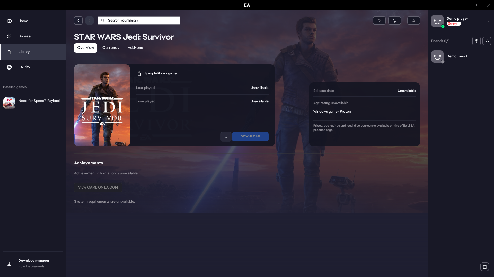
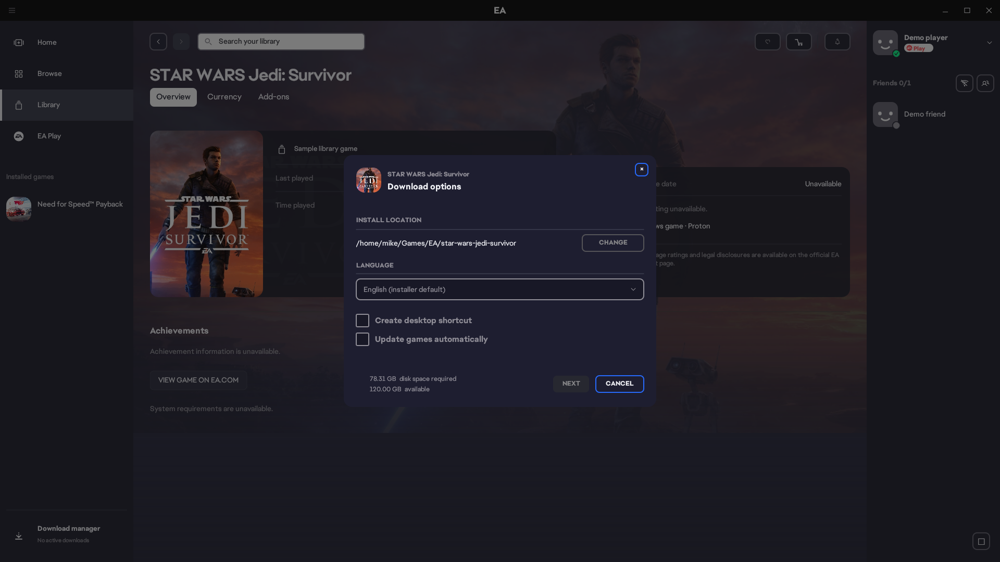
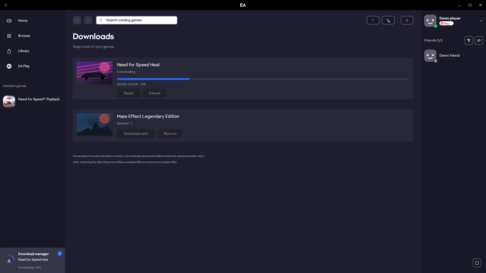
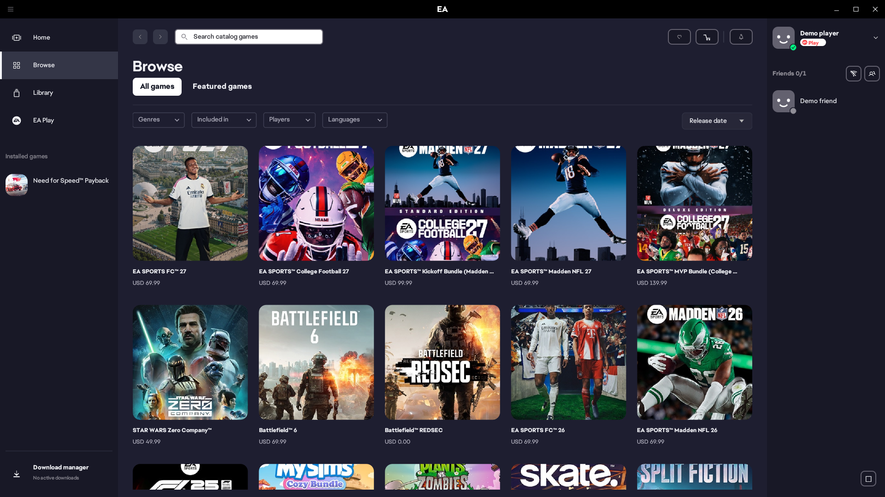
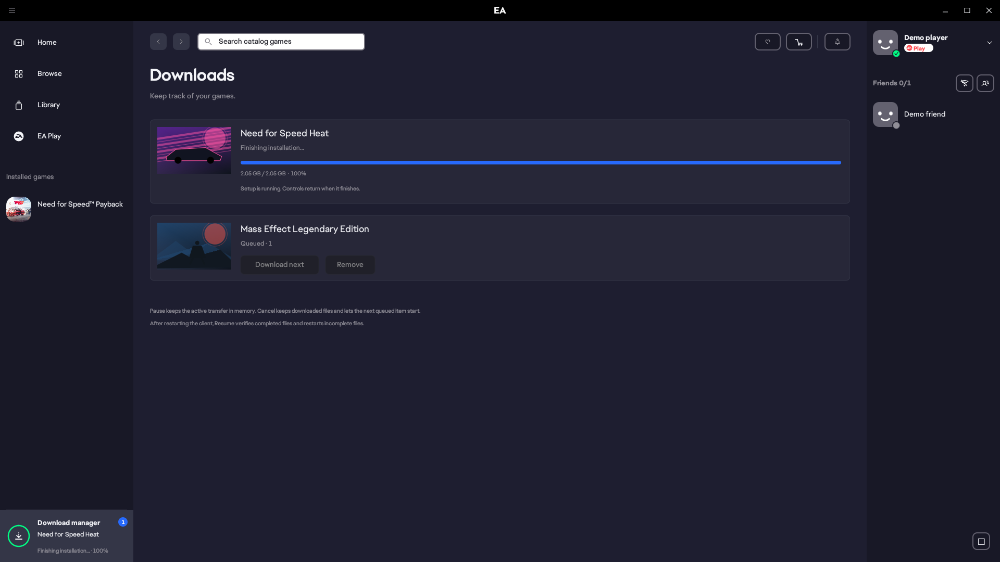
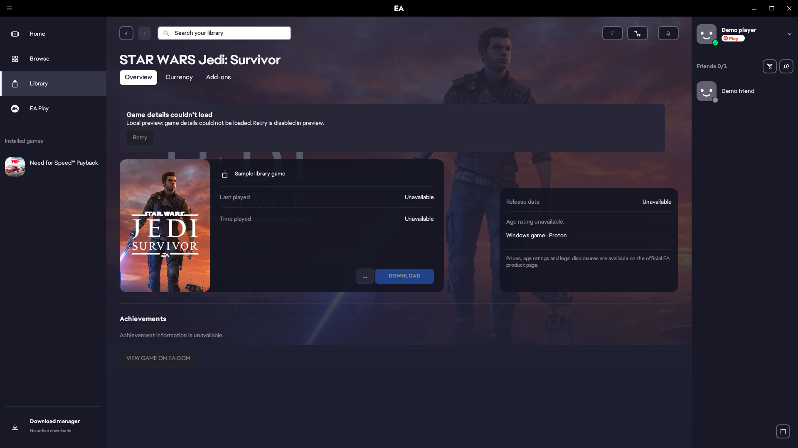
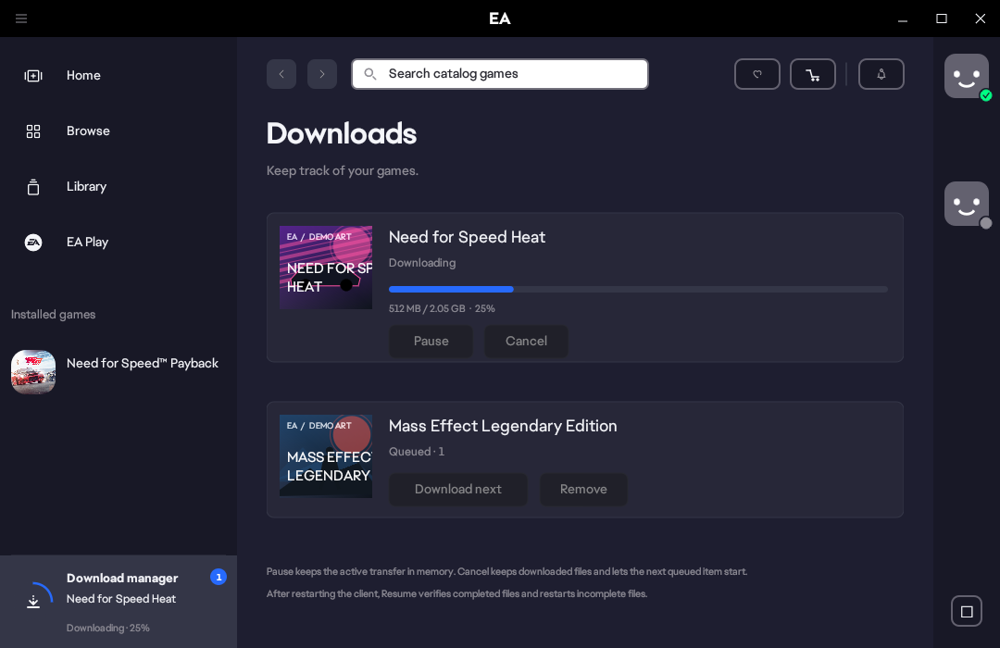

<div align="center">

# AE app for Linux

**A native Linux launcher for Windows EA games, built with Rust and powered by Proton.**

[](https://github.com/slaveitgr/AE-app-for-Linux/actions/workflows/build-ci.yml)
[](LICENSE)

[Get started](#get-started) · [Interface tour](#interface-tour) · [Project status](#project-status) · [Verification](docs/verification.md) · [Ελληνικός οδηγός](README-LINUX.md)

</div>


**aeapp** brings a Windows EA app inspired interface to a native Linux desktop: browse your library, manage downloads in the background, and launch supported Windows games through umu and Proton. The launcher itself runs natively on Linux.

An independent community project derived from [Maxima](https://github.com/ArmchairDevelopers/Maxima). It is **unofficial and not affiliated with or endorsed by Electronic Arts**.

<sub>All interface screenshots show local demo data. Optional locally imported EA artwork and fonts are used in these captures; a fresh source build uses bundled fallback assets. Sample games, prices, membership and progress do not establish ownership, current offers or Linux compatibility.</sub>

## What we have built

- **A native desktop interface.** Home, Browse, EA Play, Library, Profile, Settings and a Windows-style Game Hub with Overview, Currency and Add-ons tabs.
- **Downloads that remain visible and controllable.** A persistent queue, Pause/Resume/Retry/Cancel, reordering, and a bottom-left indicator shared with the full download manager.
- **Background operation.** Close the window to keep the client and downloads running. A registered tray offers Open, Settings and Exit; desktops without a usable restore path receive a minimize request.
- **Windows game installation on Linux.** Explicit PCWIN build checks, destination disk-space checks, install preparation, and managed umu/GE-Proton setup.
- **Per-game Proton controls.** Select a local Proton directory, enable diagnostic logging, or change Esync/Fsync settings.
- **Visible failure and recovery states.** Matching backend acknowledgments, retryable errors, stale-result protection and unavailable statistics that stay distinct from genuine zeroes.

## Interface tour

Click any screenshot to see it at full resolution.

| Library | Game Hub |
| --- | --- |
| [](docs/screenshots/library.png) | [](docs/screenshots/game.png) |
| Square covers, installed games, owned titles and per-game menus. | Game actions, installation details and explicit unavailable-data states. |

| Download options | Download manager |
| --- | --- |
| [](docs/screenshots/install.png) | [](docs/screenshots/downloads.png) |
| Destination, archive-size estimate, available disk space and queue confirmation. | Current transfer, waiting items and the persistent sidebar indicator. |

<details>
<summary><strong>Browse, recovery states and compact layouts</strong></summary>

### Browse a local public-catalog snapshot



The optional catalog importer retains actual public product names, artwork and captured price/currency labels. Browse reads that local cache; product links lead to the official EA store. The catalog is separate from your owned-game library and subscription entitlements.

### Follow installation through its final stage



Finalizing identifies the setup stage and disables transfer controls while the installer runs. Unknown-size transfers avoid invented percentages. Failed requests retain an error and the appropriate recovery action.

### Recover when details fail to load



A failed details request has a distinct Retry state. Missing playtime, achievements, dates or ratings are shown as unavailable. In these isolated screenshots, actions are disabled because no EA backend is running.

### Use a smaller window



</details>

## Get started

### Build and explore without signing in

Install the build prerequisites from the [Linux setup guide](README-LINUX.md#build-από-τον-πηγαίο-κώδικα), then:

```sh
git clone https://github.com/slaveitgr/AE-app-for-Linux.git
cd AE-app-for-Linux
./scripts/build-linux.sh
./target/release/aeapp --preview --preview-page home
```

Preview mode uses local fixtures, starts no EA backend, and does not sign in, launch a game, or download games/runtimes. An X11 or Wayland graphical session is required.

### Install and connect your account

```sh
./scripts/install-linux.sh --from target/release
~/.local/bin/aeapp
```

The installer adds **aeapp** to the application menu, installs the companion binaries, and registers the browser login callback. No root access is needed for this user installation. Normal mode opens EA sign-in in the system browser.

Keep `aeapp`, `aeapp-bootstrap` and `aeapp-cli` together. The first game setup may download Proton and runtime components. See the [Linux guide](README-LINUX.md) for data locations, dependencies, desktop integration and local asset import.

Successful [GitHub Actions runs](https://github.com/slaveitgr/AE-app-for-Linux/actions/workflows/build-ci.yml) also provide a native x86_64 build artifact with binaries and preview screenshots. These CI packages use the bundled fallback assets.

## A typical session

1. **Sign in and load your library.** Normal mode reads your EA account's game information; public catalog entries remain separate.
2. **Open a game's Overview.** Choose Download or Play according to its real installation state, or open its Proton settings.
3. **Choose an installation folder.** A Windows build and its space requirement must be verified before the download can be queued.
4. **Follow the transfer anywhere.** The bottom-left Download manager opens Downloads. Closing the window keeps the process running; explicit Exit ends it.
5. **Launch through Proton.** Once installation succeeds, the native backend starts the Windows game through umu and the selected Proton runner.

The queue survives a client restart in a paused state. Resume verifies complete files; incomplete files restart after a process restart. Pause/Resume within the same process retains the active transfer in memory. If Exit is requested while queue acceptance is still pending, the client asks you to wait for that result before exiting.

## Project status

**Need for Speed Payback has a user-confirmed gameplay result** with the native backend, GE-Proton11-11 and an EA Play entitlement through Game Pass. This is a result for one tested game and workstation; the latest UI milestone did not repeat that gameplay session.

| Area | Current state |
| --- | --- |
| Native desktop screens and local preview | Implemented; loading, error and compact layouts covered by isolated previews |
| EA login, library, PCWIN installation and launch | Connected to the native backend; Payback is the recorded end-to-end result |
| Download queue and controls | Implemented, with persistence, matching acknowledgments and recovery states |
| Tray and background operation | Registered tray can hide/restore; fallback requests minimization; desktop support varies |
| Game Hub and subscription badge | Available; badge follows subscription state; unsupported statistics remain unavailable |
| Cloud-save integration | Present in the backend; live-save round trips are outside the latest verification |
| Full in-app checkout, complete DLC management and uninstall UI | Incomplete |
| Additional installer languages, game shortcuts, automatic game-update policy and some catalog filters | Not yet enabled |
| Complete original-client parity and general game compatibility | Work in progress |

Games protected by unsupported platform or anti-cheat requirements may not run. Each game's compatibility needs its own result. A native launcher does not provide Windows kernel or anti-cheat support.

## Engineering and verification

The latest local milestone, recorded on **23 October 2026**, passed:

| Verification | Result |
| --- | --- |
| Automated tests | **76 passed, 0 failed**: 39 library, 35 UI, 2 browser callback |
| Tests requiring a live EA account | **2 ignored** |
| Release builds | **UI, bootstrap and CLI passed** |
| Isolated preview renders | **24 successful**, at 1920×1080 and 1080×700 |
| Manual visual review | **14 representative renders** |

The [verification record](docs/verification.md) separates local checks, earlier gameplay confirmation and areas not yet validated. The CI badge above reflects GitHub Actions for the current branch; it is separate from these recorded local results.

```sh
cargo test --workspace --all-targets --locked
cargo build --locked --release -p aeapp-ui -p aeapp-bootstrap -p aeapp-cli
```

The repository pins **Rust 1.93.0 stable** and includes `Cargo.lock`. The [Linux CI workflow](.github/workflows/build-ci.yml) runs tests, builds the native client, renders isolated previews and uploads build artifacts. Ignored live-account tests are not run unattended.

Windows screenshots, native resource inspection and Qt bridge analysis guide the interface work. The original production desktop SPA and its complete DOM have not been recovered. See the [original-client investigation](docs/reverse-engineering.md) for evidence and implementation boundaries.

## Contributing

[Open an issue](https://github.com/slaveitgr/AE-app-for-Linux/issues) with the affected screen or game, expected behavior, Linux distribution, desktop environment and Proton version. Focused bug reports, reproducible compatibility results, tests and UI improvements are welcome. Keep account credentials, license files and private logs out of public reports.

## Credits and license

Derived from **[Maxima](https://github.com/ArmchairDevelopers/Maxima)** by Sean Kahler and its contributors. This fork builds on their native EA integration and retains upstream authorship notices. See [CREDITS.md](CREDITS.md) for attribution and the Origin SDK discovery investigation.

Game execution uses **[umu](https://github.com/Open-Wine-Components/umu-launcher)** and **[GE-Proton](https://github.com/GloriousEggroll/proton-ge-custom)**. Source code is distributed under **[GPL-3.0](LICENSE)**. EA and game names, artwork, fonts and trademarks belong to their respective owners; original EA client bundles and imported reference assets are excluded from the source repository.
